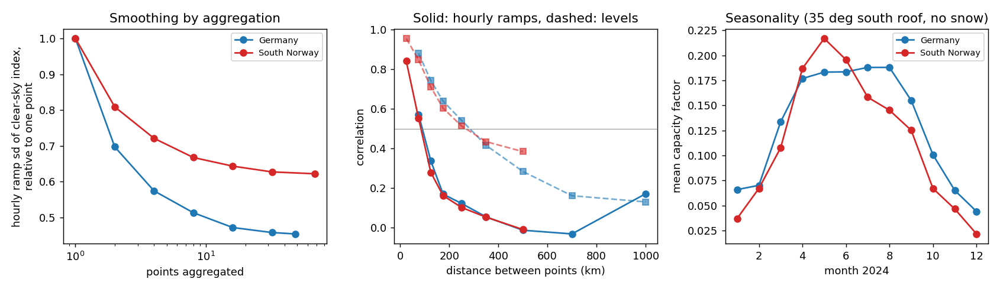
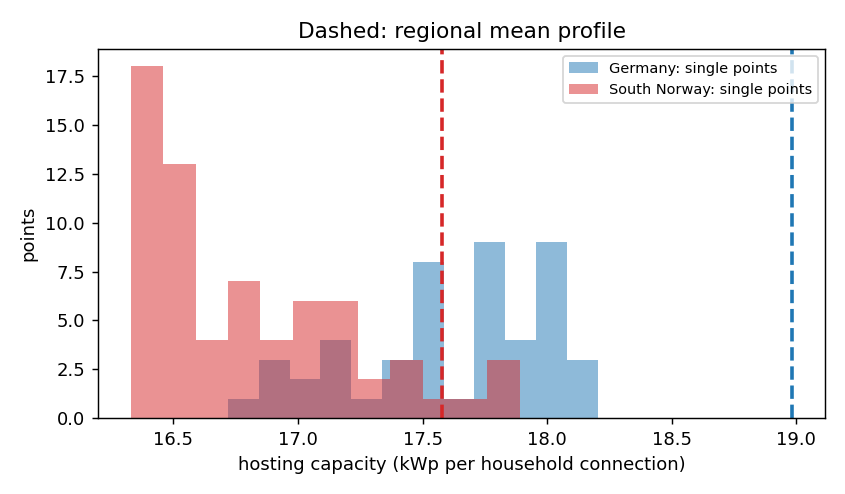

# pv-regional-smoothing

How does the variability of PV production fall when many sites are added, how much energy does snow take in southern Norway
against Germany, and does a regional average profile mislead the planning of a low-voltage feeder? A study on one year (2024) of
ERA5 weather at 48 points in Germany and 68 land points in southern Norway, a PV model in pvlib, a check against the ENTSO-E solar
generation of the four German control areas, and the hosting capacity of a SimBench low-voltage feeder.

Research study on public data. **There is no Norwegian measured PV, irradiance or grid data in it** (the Solvar datasets are not
public), so the Norwegian results are model results and are not validated. The PV fleet is one assumed system (35 degree tilt, south).

## Data

- Weather: ERA5 hourly reanalysis (Copernicus Climate Change Service) via the Open-Meteo archive API (`models=era5`, CC BY 4.0):
  global, direct and diffuse radiation, temperature, 10 m wind, snowfall and snow depth, 2024. Germany: a 1 degree grid, the 48 points
  inside a coarse outline of the country (47.5 to 54.5 N, 6.5 to 14.5 E; mean distance between two points 334 km, largest 806 km).
  South Norway: a 0.5 degree grid between 58.75 and 61.75 N and 7 and 12 E, 68 land cells west of the Swedish border (mean distance
  174 km, largest 433 km). A cell is a grid cell of the reanalysis (about 25 km), not a site; 21 of the 68 Norwegian cells have a model
  elevation of 1,000 m or more, so many are mountain plateaus without PV.
- Measured production: ENTSO-E Transparency Platform, actual solar generation (A75, B16) of 50Hertz, Amprion, TenneT, TransnetBW and
  of DE-LU, 15 minutes, 2024.
- Low-voltage feeder and loads: SimBench `1-LV-rural1--0-sw` (13 household loads, one 160 kVA transformer).

Raw files are not in the repository; `scripts/download_weather.py` and `scripts/download_entsoe_zones.py` fetch them (the ENTSO-E key is
read from `ENTSOE_API_KEY` or `~/.entsoe_token`).

## Model

`src/pvregional/pv.py`: plane-of-array irradiance from ERA5 global, direct and diffuse radiation (Hay-Davies, tilt 35 degrees, south,
albedo 0.2 and 0.6 with more than 5 cm of snow depth); cell temperature by the Faiman model; PVWatts-type DC power (temperature
coefficient -0.35%/K, 14% losses); inverter clipping at a DC/AC ratio of 1.15; the NREL snow cover model of pvlib (cover from snowfall,
removed by sliding and melting). The same chain with clear-sky irradiance (Ineichen) gives the clear-sky production, so that variability
is measured on the **clear-sky index** (production over clear-sky production), which removes the daily cycle that otherwise makes all
points look alike. Modelled yield: 1,139 kWh per kWp in Germany and 1,006 in southern Norway (mean of the points, no snow); the level
of ERA5 irradiance was not checked against measurements.

## Results

### Smoothing

Aggregate of n randomly drawn points (mean of 200 draws), hourly ramps of the clear-sky index in daytime, relative to one point:

| | 8 points | all points | 99th percentile of the ramp, all points | largest ramp, all points | distance at which the correlation of ramps falls below 0.5 |
|---|---|---|---|---|---|
| Germany (48 points) | 0.51 | 0.45 | 0.56 | 0.24 | about 90 km |
| South Norway (68 points) | 0.67 | 0.62 | 0.66 | 0.50 | about 85 km |



- Smoothing is fast at first and then saturates: eight points give most of the gain. In Germany the correlation of hourly ramps is 0.12 at
  200-300 km and about zero beyond 400 km; the level of the clear-sky index stays correlated longer (about 280 km to 0.5). The largest
  single-hour ramp of the aggregate is a quarter of the single-point value in Germany and half in Norway.
- Norway smooths less in this set. Its points lie closer together (mean distance 174 km against 334 km) and ramps there may be more
  local (valleys, fjords); the study does not separate the two.
- ERA5 cells are about 25 km and hourly: variability below that scale and below one hour is not in the data. In the measured German
  series (ENTSO-E DE-LU) the standard deviation of 15-minute ramps is 1.8% of the 99.9th percentile of production and that of
  hourly-mean ramps 7.0%, so ramps grow with the time step and the hourly values say nothing about the 15-minute ramps a grid operator sees.

### Check against measured German production

Each control area is the mean of the points inside a rough rectangle (the assignment is approximate and the rectangles are not the real
borders); the model is scaled to the measurement by one factor (the installed capacity and the orientation mix of the fleet are not
known to the model) and scored on shape.

| Area | Points | Correlation of hourly series | Ramp sd, model / measured | Correlation of hourly ramps |
|---|---|---|---|---|
| 50Hertz | 14 | 0.97 | 0.92 | 0.57 |
| Amprion | 5 | 0.95 | 1.02 | 0.44 |
| TenneT | 24 | 0.96 | 0.89 | 0.53 |
| TransnetBW | 5 | 0.95 | 0.77 | 0.48 |
| Germany (DE-LU) | 48 | 0.97 | 0.85 | 0.60 |

The model follows the measured production closely and **understates the hourly ramps by about 15%** for Germany as a whole (77% to
102% for the areas), as expected from coarse cells and one panel orientation. The smoothing results above therefore, if anything, overstate
the smoothing. The scale factor (56 GW for Germany) is the size of an all-south 35 degree fleet that reproduces the measured energy
and is not an installed capacity.

### Snow

| | Germany | South Norway |
|---|---|---|
| Annual energy lost to snow cover, mean of the points | 0.14% | 2.4% (0.9% for the 20 cells below 500 m) |
| Largest annual loss of a point | 3.7% | 11.2% (cell at 1,651 m) |
| January / February (energy-weighted over the points) | 0.7% / 0.2% | 22.5% / 21.3% |
| December | 1.7% | 11.6% |
| Correlation of annual loss with cell elevation | 0.74 | 0.73 |

Production is lowest in December and January in both countries (capacity factor 0.04 and 0.07 in Germany, 0.02 and 0.04 in Norway) and
in April and May Norway is above Germany (0.19 and 0.22 against 0.18 and 0.18). **The snow model is not validated against any
measurement**; the winter losses are model values for ERA5 cells, high for the mountain cells.

### Hosting capacity of a low-voltage feeder

Every household gets the same PV size; the hosting capacity is the largest size for which, in the critical hours, no bus is above 1.05 pu
and no line or the transformer above 100% (pandapower, `src/pvregional/feeder.py`; the 2016 SimBench load year is mapped by position to
2024). The profile is either that of **one** weather point or the **regional mean** profile of the same country.

| Profile | Germany | South Norway |
|---|---|---|
| One point (mean of the points, range) | 17.6 kWp (16.7-18.2) | 16.8 kWp (16.3-17.9) |
| Regional mean profile | 19.0 kWp | 17.6 kWp |
| Regional mean against one point | +7.8% (+13.6% against the lowest point) | +4.7% (+7.7%) |



The regional average, which is smoothed, gives a higher hosting capacity than any single point of the same country: a planner using a
regional mean profile for one feeder would overstate the capacity by 5 to 8% on average and by up to 14% against the lowest point. The differences are modest because the points here are
cells of 25 km with similar clear-sky peaks. The 60 critical hours used in the search were checked: at the found capacity none of the
600 highest-scoring hours violates a limit, and at 5% above it 6 to 16 do (`scripts/check_hosting.py`, `results/hosting_check.csv`, three
profiles).

## What this is not

- Not a model of the Norwegian fleet or grid: no Solvar data, no measured Norwegian PV, no real distribution grid, no hosting capacity
  of a real feeder. The only network is a synthetic German SimBench feeder.
- Not a snow model that has been checked; not a result about snow on real systems (tilt, glazing and ground effects are ignored).
- Not the interaction with wind or run-of-river hydropower (not done), not 15-minute resolution, no building stock or orientation mix.
- One year (2024), equal weight for every point (no capacity or population weighting), approximate control-area borders.

## Run

```
pip install -e ".[test]"
python scripts/download_weather.py            # about 15 minutes (Open-Meteo rate limits)
python scripts/download_entsoe_zones.py
python -m pvregional.run                      # about 10 minutes on 8 cores, mostly the hosting capacity
python scripts/check_hosting.py
pytest
```
